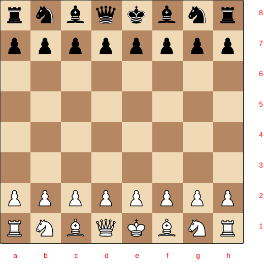

# Rules

These are the rules of Chess.

Based on the [Chess](https://en.wikipedia.org/wiki/Chess) article on Wikipedia.

## Setup

- The board is 8×8: files `a`–`h` (left to right from White's view), ranks
  `1`–`8` (bottom to top from White's view). Squares are named like `a1`.
- `a1` is a dark square; `h1` is a light square.
- White occupies ranks `1` and `2`; Black occupies ranks `8` and `7`.
- Back rank order for both sides: `R N B Q K B N R` (White on rank 1,
  Black on rank 8, kings on `e1`/`e8`, queens on `d1`/`d8`). Pawns fill
  ranks 2 and 7. This matches `Chess.Board.initial/0`.
- White moves first. Players alternate one move per turn.

## Piece movement

- **Pawn**: forward one square to an empty square; from its starting square it
  may move two squares if both are empty. Captures one square diagonally
  forward. Never moves backward.
- **Knight**: moves in an L (two squares along one axis, one along the other).
  It jumps over occupied squares; the destination must not hold a friendly piece.
- **Rook**: any number of squares horizontally or vertically, blocked by the
  first occupied square (an enemy piece there may be captured).
- **Bishop**: any number of squares diagonally, same blocking rules. Stays on
  one square color.
- **Queen**: any number of squares horizontally, vertically, or diagonally,
  same blocking rules.
- **King**: one square in any direction. May never move onto an attacked
  square (into check).

## Special moves

- **Castling**: king moves two squares toward a rook, rook jumps to the far
  side. Allowed only when:
  - king and that rook have not moved previously,
  - all squares between them are empty,
  - the king is not in check, does not pass through check, and does not land
    on check.
  King-side castling moves `e1`→`g1` (rook `h1`→`f1`); queen-side `e1`→`c1`
  (rook `a1`→`d1`). Mirrored for Black on rank 8.
- **En passant**: if a pawn advances two squares and lands beside an enemy
  pawn, that enemy pawn may capture it as if it had moved one square. The
  capture is legal only on the very next move.
- ** Promotion**: a pawn reaching the last rank must be replaced by a queen,
  rook, bishop, or knight (underpromotion allowed). The move is completed
  with the promoted piece.

## Ending positions

- **Check**: the king is attacked. The player must respond by escaping check
  (move the king, block the attacker, or capture it) — except castling, which
  is never allowed while in check.
- **Checkmate**: the king is in check and no legal move removes it. The
  player checkmated loses.
- **Stalemate**: the player to move has no legal move and is not in check.
  The game is drawn.

## Draws

TODO: threefold repetition, fifty-move rule, insufficient material —
deferred to a later pass.

## See also

- [Chess notation](https://en.wikipedia.org/wiki/Chess_notation) and
  [Algebraic notation](https://en.wikipedia.org/wiki/Algebraic_notation_(chess))
  for recording moves
- [Unicode](UNICODE.md) — the piece glyphs in this repository
